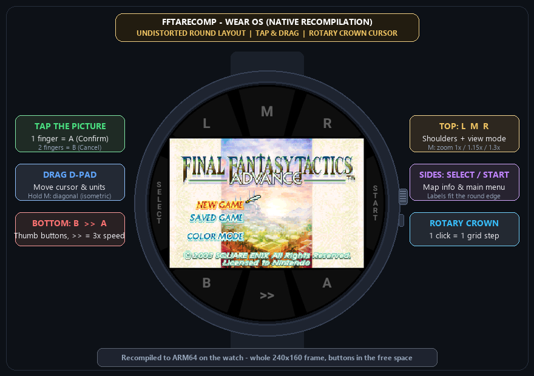

# FFTARecomp - Wear OS Port

A **Wear OS smartwatch** front end for **FFTARecomp**: *Final Fantasy Tactics Advance* recompiled to native **ARM64 code on the watch itself**, with no emulator. It runs the same Rust core as the Android port (`libgba_android.so`) and the same on-device TinyCC compiler (`libtcc.so`). Only the screen, input and ROM import are new, built for round displays. The ROM is **not** distributed: each player sends their own unmodified copy (USA or Europe, checked by SHA-1 + SHA-256).

<p align="center">
  
</p>

---

## ⌚ What We Built for Wear OS

- **⚙️ Native Recompilation on the Watch**: On first launch the watch analyzes the ROM, emits C for every ARM/Thumb block and compiles it to ARM64 with TinyCC (the same `NativeBridge.load` + `NativeBridge.prepare` path as the phone). The compiled objects are cached in the app's private storage, so later launches skip straight to the game.
- **🖼️ Undistorted Round Layout**: The whole 240×160 frame is drawn as the largest 3:2 picture that fits the round glass. Nothing is cropped, bent or stretched.
- **🔍 Three Screen Presets**: Tap **`M`** to cycle **Whole screen** (default), **Zoom** (1.15×) and **Strong zoom** (1.30×). Your choice is remembered.
- **🎮 Buttons in the Free Space**: The buttons fill the caps around the picture, and their inner edge follows the picture border, so no button covers a game pixel.
  - **`L` / `M` / `R`** (top cap)
  - **`B` / `>>` / `A`** (bottom cap, under the thumbs)
  - **`SELECT` / `START`** (side crescents)
- **👆 Tap & Drag Gestures**:
  | Gesture | Action |
  | :--- | :--- |
  | **Drag** anywhere | D-pad (the anchor follows your thumb; a quick flick = one tile) |
  | **Quick tap** on the picture | `A` (confirm) |
  | **Two-finger tap** | `B` (cancel) |
  | Dragging + **tap with another finger** | `A` without releasing the cursor |
  | **Hold `M`** | Diagonal drag on/off for isometric battle maps (up-right = ↑, up-left = ←, down-left = ↓, down-right = →) |
  | **`>>`** | 3× speed on/off |
  | Watch **back** button | `B` |
- **⌚ Rotary Crown / Bezel Cursor**: One crown click = one up/down step in menus, lists and abilities.
- **🧭 Steady D-pad**: A hysteresis band keeps the cursor from jumping between two directions while your thumb rests on a diagonal.
- **💾 Saves**: The recomp core's own save system (auto save + save slots) is used unchanged. The game also saves whenever the app leaves the screen.
- **📲 Wi-Fi ROM Transfer (QR Code)**: Wear OS has no file picker. The watch shows a QR code: scan it with your phone and send your `.gba` over Wi-Fi. The header is checked on upload and the exact hash before recompiling.
- **🎛️ Gamepads**: Bluetooth controllers and keyboards also work.

---

## 📋 Requirements

- A Wear OS watch with a **64-bit (arm64-v8a) userspace**, because TinyCC emits ARM64 code at runtime. Examples: Galaxy Watch 7 / Ultra / 8 and Pixel Watch 3. Watches that only run 32-bit apps cannot run the recompiled code.
- About 40 MB of free storage for the ROM and the compiled cache.
- Your own unmodified FFTA ROM, **USA** or **Europe**. The Japanese ROM is not supported by the recompiler.

---

## 🚀 How to Build & Install for Wear OS

### 1. Build the native core and the APK
Same prerequisites as the Android port (Rust with `aarch64-linux-android`, Python 3.9+, a JDK, Android SDK with NDK 28.2.13676358, and GCC or Clang on the host). From `AndroidPort/`:
```bash
python scripts/build_android.py --sdk <ANDROID_SDK> --wear
```
Output: `AndroidPort/APK/FFTARecomp-wearos-arm64-preview.apk`

Already built the native libraries? Then the module builds on its own:
```bash
cd AndroidPort/android
./gradlew :wear:assembleDebug
```

### 2. Install on your Smartwatch via ADB Wi-Fi
```bash
adb connect <WATCH_IP>:<PORT>
adb install -r AndroidPort/APK/FFTARecomp-wearos-arm64-preview.apk
```

### 3. ROM Setup
1. Open the app on the watch: it shows a **QR code** with the transfer address.
2. Scan it with a phone on the same Wi-Fi network and upload your `.gba`.
3. The watch checks the ROM, then recompiles it (a progress line shows each step). This happens once; later launches reuse the compiled cache.

Keep the watch unlocked with the app on screen during the upload (Wear OS blocks the network for background apps).

**Developer shortcut:** debug builds bundle any `.gba` placed in `AndroidPort/android/wear/dev-rom/` and import it on first launch. Build with `-PwearNoRom` to leave it out. `*.gba` files are git-ignored.

---

## 🗂️ Project Structure
```
AndroidPort/android/wear/
  build.gradle.kts         shares :app's engine sources, jniLibs and license assets
  src/main/java/com/fftarecomp/port/wear/
    WearActivity.kt        ROM import -> verify -> recompile -> game; crown, back, gamepad
    WatchControlsView.kt   round layout and cap buttons (drawn and hit-tested)
    WatchInput.kt          tap / drag / two-finger gestures, crown pulses, hysteresis D-pad
    RomInbox.java          local HTTP server for the Wi-Fi ROM transfer
    RomTransferView.java   QR code screen
    Page.java              upload page served to the phone
```
The engine files (`NativeBridge.kt`, `GameSurface.kt`, `VideoPass.kt`, ...) are copied from `:app` at build time, never duplicated in git, so the watch always runs the phone's current code.

---

## 📜 Credits & Acknowledgments

- **FFTARecomp** by Jorge Rios: the recompiler, the Rust core and the Android port this watch build runs on. It is based on [gba-recomp](https://github.com/JRickey/gba-recomp) by JRickey.
- Wear OS front end by Gustavo Lara.
- Original game by **Square** / **Square Enix** and **Nintendo** (2003). Final Fantasy Tactics Advance is a trademark of Square Enix. Use only your own legally owned copy.
- [TinyCC](https://github.com/TinyCC/tinycc) (LGPL-2.1, loaded as a separate `libtcc.so`; source and build settings ship in the APK's license assets) and [ZXing](https://github.com/zxing/zxing) for the QR code (Apache-2.0).
- The app icon is original artwork.
